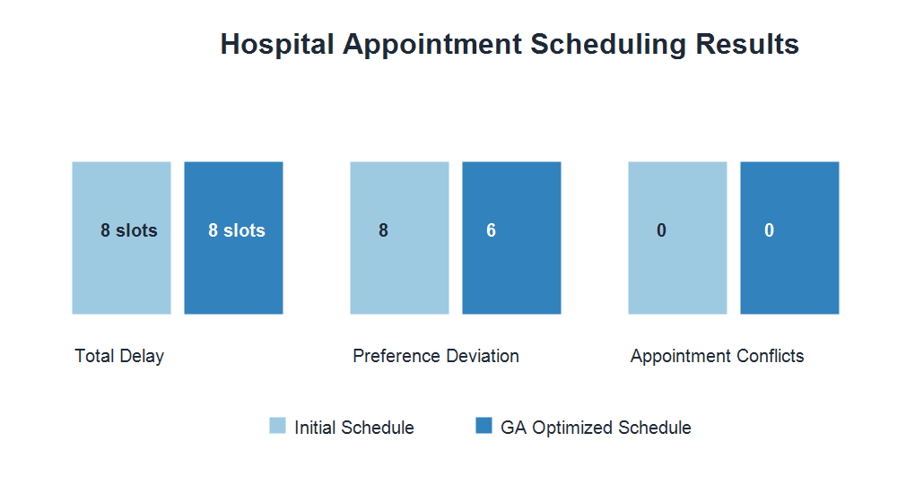

# Hospital Appointment Scheduling Optimizer

A Streamlit dashboard that uses a Genetic Algorithm (GA) to generate a valid hospital appointment schedule. It minimizes patient delay first and then improves appointment preferences.

## Project Overview

Hospitals must allocate limited doctor time to many patients without overlapping appointments. This project accepts a CSV dataset, validates it, and finds a low-cost schedule while enforcing doctor and patient constraints.

The included example uses 12 patients, 3 doctors, and 6 appointment slots. Additional datasets are included for a 15-patient clinic, a fully booked two-doctor day, and an 18-patient high-demand day.

## Repository Contents

| File or folder | Purpose |
|---|---|
| `app.py` | Streamlit dashboard and Genetic Algorithm implementation |
| `requirements.txt` | Required Python packages |
| `dataset_*.csv` | Test datasets for demonstrations |
| `test_appointment_dataset.csv` | Original 12-patient sample dataset |
| `docs/problem_statement.md` | Project problem, objectives, and constraints |
| `docs/performance_analysis.md` | Result comparison and interpretation |
| `docs/references.md` | Recent IEEE-style references |
| `screenshots/results_comparison.png` | Result visual for the README and LinkedIn post |

## Use your own dataset

1. Start the dashboard and choose **Upload my CSV file**.
2. Click **Download CSV template** and open it in Excel.
3. Replace the example rows with your own patients, then save it as a CSV file.
4. Upload that file and click **Run Genetic Algorithm**.

Your CSV must contain these exact columns:

```text
patient_id,specialty,doctor,requested_slot,preferred_slot
P1,Cardiology,Dr. A,1,2
P2,Cardiology,Dr. A,1,4
```

Slots are numbered 1 through 6 (09:00–09:30 through 11:30–12:00). A doctor may have at most six patients. The application checks that the data can satisfy the scheduling constraints before optimization starts.

## What the dashboard shows

- The initial schedule compared with a GA-optimized schedule.
- Total delay, preference deviation, conflicts, and the objective cost.
- The final appointment table.
- Fitness convergence, doctor workload, and patient-wise delay charts.

The objective is preserved from the project:

`objective cost = 100 × total delay + preference deviation`

The high weight on delay means the GA first avoids unnecessary patient waiting, then uses preferences to choose among good schedules.

## Result Summary

For the included 12-patient dataset, the reported optimized solution retains the minimum observed total delay of 8 slots and improves preference deviation from 8 to 6. It has zero appointment conflicts.



See [performance analysis](docs/performance_analysis.md) for the complete interpretation.

## Hard constraints

1. Every patient gets one appointment.
2. A patient is not scheduled before their requested slot.
3. A doctor cannot have two appointments in one slot.
4. Only the six displayed slots may be used.

## Run locally

1. Install Python 3.10 or later from [python.org](https://www.python.org/downloads/).
2. Open a terminal in this folder.
3. Install the libraries:

   ```powershell
   python -m pip install -r requirements.txt
   ```

4. Start the dashboard:

   ```powershell
   python -m streamlit run app.py
   ```

5. Open the local address shown in the terminal, normally `http://localhost:8501`.

## Use in Google Colab

Streamlit needs a browser tunnel in Colab. In a new Colab notebook, upload `app.py` and then run:

```python
!pip -q install streamlit pandas matplotlib pyngrok
!streamlit run app.py --server.port 8501 &>/content/streamlit.log &
```

Then create a public tunnel using a service of your choice (for example, ngrok). A local computer is usually simpler for demonstrating the app.
